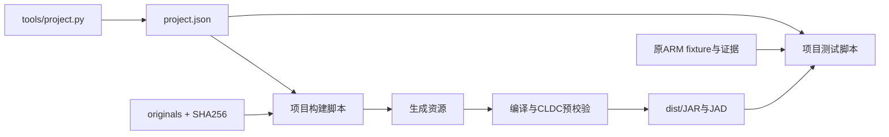

# 仓库架构

## 项目是隔离单位

一个 BREW 软件对应 `projects/<slug>/`。slug使用稳定的英文小写/数字/连字符，显示名可以中文。注册信息来自该目录的 `project.json`；根工具自动发现，不依赖一份易失同步的中央列表。

每个项目包含：

- `originals/`：输入包、来源说明、原版存档样本、SHA256清单。分析和构建只读，不在里面保存模拟器运行中的新存档。
- `docs/`：评估、格式、恢复状态、差异说明、验证记录；可读逆向证据可放 `docs/reverse/`。
- `j2me/` 等目标目录：该目标的实现、测试和专用工具。未来其他平台与它并列，不能依赖另一个项目的业务代码。
- `project.json`：ID、显示名、状态、目标构建/测试脚本、产物路径、原始输入清单路径。

原始包保留自身目录结构。项目专用工具不得猜测其他项目的资源格式；有第二个真实使用者后再提炼公共解析器。

## 公共工具与项目的接口

`tools/project.py` 只负责发现项目、校验输入、调用项目的Python构建/测试入口。路径相对项目根目录，子进程工作目录为脚本所在目录；不使用shell拼接命令。每个项目负责自己的资源流程、编译选项和测试断言。

`tools/toolchain.py` 集中处理工具链环境变量和本地JSON配置。公共工具不导入任何项目业务实现。`projects/biohazard/j2me/build.py` 和 `test.py` 引用此工具链配置，其余格式/ARM处理脚本仍在游戏项目内。

## 当前游戏内部

`BioMIDlet → OriginalCanvas → OriginalSession`。Canvas处理MIDP输入、菜单与绘图；Session协调Player、VM、Combat和关卡切换。`bio.original` 下的状态/逻辑不依赖MIDP API，便于和原ARM结果对照。`OriginalRenderer`使用原几何/素材做Java适配渲染，`OriginalSaves`负责RMS，`SaveCodec`负责可独立测试的快照格式。

`tests/midp/` 只是桌面测试适配器，构建不会打入JAR。早期 `GameCanvas/GameState/RayRenderer/SaveStore` 仍保留作历史样例；默认入口使用Original系列，本轮目录整理不修改它们的玩法。

## 可重建数据与证据

`j2me/resources/`、`build/`、`dist/`都是从原始输入和代码生成的数据，不追踪。原始ARM fixture虽然可重新执行生成，但承担回归基线作用，应追踪；不能把期望数据在每次测试前静默重写。更新fixture需说明来源和原因。

逆向文本导出和人工分析文档追踪；IDA数据库留本地。若数据库包含尚未导出的重命名/类型/备注，应先导出并单独备份数据库。Git忽略不代表文件没有价值，更不会自动备份它。

不把模拟器安装目录、SDK、账户数据和运行期RMS混入源目录。后续需要版本控制的非生成素材，应放在目标的独立 `assets/` 路径并让构建显式复制，不能直接修改会被重建的 `resources/`。

## 这次迁移映射

| 旧路径 | 新路径 |
|---|---|
| `j2me-src/` | `projects/biohazard/j2me/` |
| `docs/` 中的游戏文档和逆向记录 | `projects/biohazard/docs/` |
| `3D生化启示录/` | `projects/biohazard/originals/` |
| `runs/` | `.local/runs/` |

原始输入移动前生成SHA256清单，移动后核验。没有保留旧路径软链接，防止新脚本继续依赖旧结构；已有模拟器启动参数应改用新的JAR路径。
