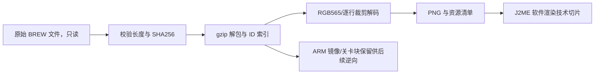

# 资源格式与证据

所有偏移为文件内偏移，除非明确注明“解压后”。整数默认小端。解析器见 `j2me/tools/extract_assets.py`。

## bin.dat

`u32 compressed_size` 后跟 gzip；本包值 82785，精确等于文件长度减 4。解压大小 171828。输出仅供逆向，不将 ARM 代码装入 MIDlet。

## mbxres.bin

`u32 count=39`，从 0x04 起为 `count*u32 resource_id`，从 0xa0 起为 `count*u32 absolute_end`，数据起点 0x13c。第 i 段起点为前一段终点（第 0 段用 0x13c）；各段为独立 gzip。

ID 30000/30001 为 MIDI。52000..52015 已由原ARM加载器0x18B5C确认是关卡数据，开头 `u16 width,height`：60×30、60×30、50×40、50×50、60×40、60×40、50×50、50×50、20×20、30×20（5 份）、50×50、30×30。完整格式、碰撞展开、12/8/12/20字节记录及原出生点证据见 [逻辑移植记录](04-original-logic-port.md)。16关已完成严格EOF检查。

0.2.0另确认：ID0是526条UTF-16LE文本，内部索引同样是结束偏移；ID10000是原字库，索引小端但中文字形行是大端；11000..11015是事件脚本；51000是精灵/盒体/实体/效果/墙纹理描述表。详见上述记录及 `reverse/scripts.json` / `reverse/texts.json`，不要沿用初探的文本偏移猜测。

## map.hkm

**已纠正初探错误**：第一个 u32 是 count，不是第 0 个 offset。不存在所谓 `0xd7..0x6bc` 的特殊图像记录。

- `u32 count=215`
- `count*u32 start_offset`，从 0x04 起。
- `count*u32 resource_id`，从 0x360 起。
- 首条记录从 0x6bc (1724) 起，ID=1000。
- 每条记录头 16 B：`u16 width,height,flags,color_key; u32 reserved; u32 gzip_length`。
- gzip 后存在最多 3 字节记录对齐空间；解压内容先有 `4*height` 字节全零区，疑似运行期行指针工作表，语义尚未由 ARM 代码确认。

### RGB565 数据

flags=0x00/0x20：跳过 `4*height` 后连续读取 width*height 个 u16 RGB565，row-major。

flags=0x10/0x30：零区之后依次为 `height` 个左边距、`height` 个有效像素数、`height` 个行标志。注意第二数组是数量，**不是右边界**。像素起点为 `align2(7*height)`，每行从左边距开始放置有效像素数个 RGB565；省略区域透明，匹配 color_key 的像素透明。第三数组的具体用途仍未知；数据消费与已查看图像支持此解码方案。尾部对齐至 4 字节。

flags=0x11：5 条（4111..4115）尚不解码，保留原始记录；不宣称 215 张全部恢复。

已视觉确认 ID5045 是原版封面；5049 是中文区域地图；1101..1175 包括墙壁、门窗、车辆等贴图；7001..7005 为角色头像。资源的游戏内语义除已明确图像外仍需运行验证。

## 处理链

